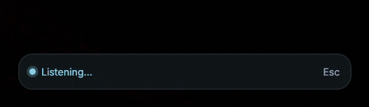
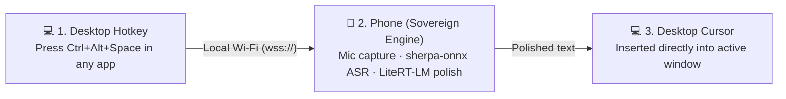
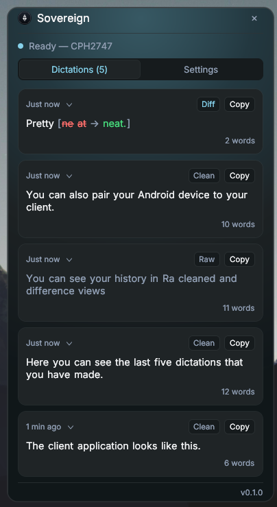

# Sovereign Desktop Client

The lightweight Windows companion for **[Sovereign](https://github.com/AlexeiKramm/sovereign)** — the private, on-device smart dictation app for Android.

Your phone acts as your microphone and on-device AI compute engine (speech recognition + local LLM cleanup), while this desktop companion allows you to dictate directly into any Windows application at your active cursor over your local network.

No cloud, no accounts, and no audio ever leaves your local Wi-Fi. Your PC does not need a microphone or AI-capable hardware.

<p align="center">
  
</p>

---

## The Sovereign Architecture



- **Main Repository & Documentation:** All architectural specifications, Android app code, model guides, and protocol definitions live in the primary repository: **[https://github.com/AlexeiKramm/sovereign](https://github.com/AlexeiKramm/sovereign)**.
- **This Repository:** Holds the standalone Windows desktop client (`sovereign-client.exe`), written in Go with zero external runtime dependencies.

---

## Features

- **Global Hotkey:** Press `Ctrl+Alt+Space` (customizable) to dictate into any window (Word, browser, code editors, chat).
- **Smart Dictation Modes:** Supports tap-to-toggle, hold-to-talk, and automatic detection (short tap toggles; hold records while held).
- **Floating Pill Overlay:** Unobtrusive click-through overlay showing live settled text in white and in-progress speech in gray.
- **Clean Insertion:** Inserts text instantly at your cursor (paste-insert with clipboard restoration, or synthetic typing fallback).
- **Control Window:** Left-click the tray icon to view live dictation history, processing latency, connection status, and settings.
- **Private & Direct:** Connects directly to your phone over local Wi-Fi with encrypted WebSockets (`wss://`) and mutual fingerprint pairing.

---

## Getting Started

### 1. Requirements
- A phone running **Sovereign** on the same local Wi-Fi network.
- Windows 10 or Windows 11.

### 2. Quick Setup

1. **Start the Phone Server:** On your phone, open Sovereign, go to **Settings → Desktop Server**, and enable the server.
2. **Download the Desktop Client:** Grab the latest `sovereign-client.exe` from the [Releases page](https://github.com/AlexeiKramm/sovereign/releases).
3. **Run and Pair:**
   - Launch `sovereign-client.exe`. It starts in your Windows system tray.
   - Click the tray icon and select **Pair with phone…** (or let it auto-discover your phone via mDNS).
   - An approval prompt will appear on your phone screen. Tap **Allow**.
4. **Dictate:**
   - Focus any text field on your PC and press `Ctrl+Alt+Space`.
   - Speak toward your phone. As soon as you finish, the polished text appears at your PC cursor.

---

## Settings & Controls

Left-click the tray icon to open the **Control Window**:

<p align="center">
  
</p>

- **Dictation Mode:** Auto (tap or hold), Hold to talk, or Press to toggle.
- **Set Custom Hotkey:** Rebind to your preferred keyboard combination.
- **Insertion Method:** Fast clipboard paste (restores previous clipboard) or direct typing.
- **After Each Utterance:** Automatically append a space, newline, or nothing.
- **Overlay Position:** Bottom Right, Bottom Left, Top Right, or Top Left.
- **Start with Windows:** Toggle automatic launch on user login.

Diagnostics and logs are written to `%LOCALAPPDATA%\Sovereign\sovereign-client.log`.

---

## Build from Source

Requires Go 1.22+ on Windows:

```powershell
# Clone the repository
git clone https://github.com/AlexeiKramm/sovereign-client.git
cd sovereign-client

# Run tests
go test ./...

# Build the GUI binary (no console window)
go build -ldflags "-s -w -H=windowsgui" -o sovereign-client.exe ./cmd/sovereign-client
```

---

## License

Apache-2.0 License. See [LICENSE](LICENSE). The main
[Sovereign repository](https://github.com/AlexeiKramm/sovereign) holds the Android app.
